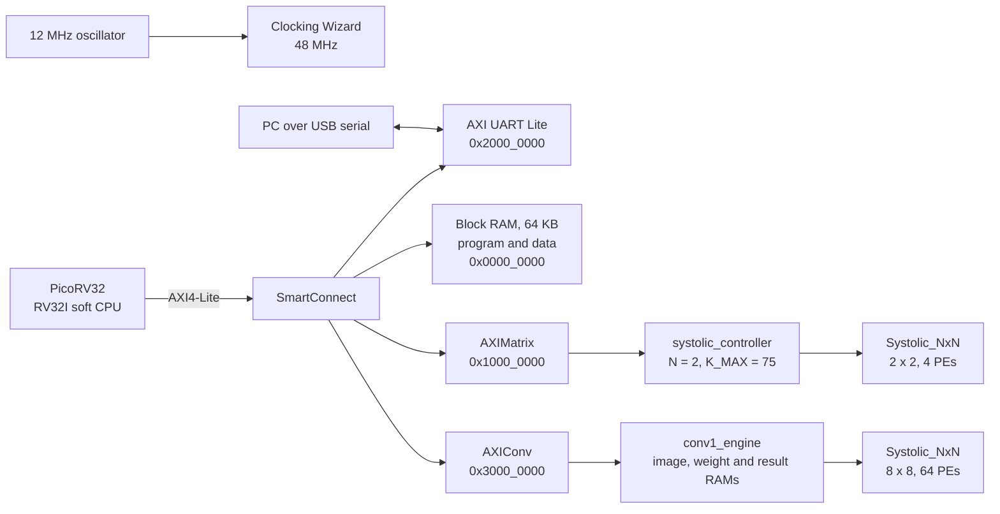

# Systolic matrix multiplier on an Artix-7, driven by a RISC-V soft CPU

A parameterized N x N systolic array that multiplies signed 8-bit matrices, written in
SystemVerilog and running on a Digilent Cmod A7-35T (Xilinx `xc7a35tcpg236-1`).
On the board it sits behind AXI4-Lite next to a PicoRV32 CPU, and an 8 x 8 instance
computes the first convolution layer of a small CNN.

| | |
|---|---|
| Operation | `C = A x B`, A is N x K, B is K x N, K = 1 to 75. Signed 8-bit in, signed 32-bit out |
| Latency | `K + 2N - 1` clocks from start to done (a square N x N product is `3N - 1`) |
| Clock on the board | 48 MHz, timing met with 5.52 ns of slack (about 65 MHz possible as placed) |
| Whole design on the FPGA | 13,800 LUTs (66%), 15,521 flip-flops (37%), 23 block RAM tiles (46%), 0 DSPs |
| Verification | 1,000 jobs per run checked against a NumPy reference, five array sizes; full-system simulation; self-test on the board |

## Block diagram



The array itself (`Systolic_NxN.sv`, shown for N = 2):

```
               b_in[0]       b_in[1]
                  |             |
                  v             v
  a_in[0] --> [ PE 0,0 ] --> [ PE 0,1 ]
                  |             |
                  v             v
  a_in[1] --> [ PE 1,0 ] --> [ PE 1,1 ]
```

Each processing element (`pe.sv`) registers its A input and passes it right, registers its
B input and passes it down, and adds `A * B` to its own 32-bit sum when both are valid.
`PE[i][j]` ends up holding `C[i][j]`.

`systolic_controller.sv` feeds the array. Row `i` and column `i` start `i` clocks after
row 0 and column 0, so term `k` of row `i` and term `k` of column `j` arrive at
`PE[i][j]` on the same clock, `k + i + j` clocks after the first term enters.

## Interface

### `systolic_controller` (the multiplier core)

| Port | Dir | Width | Meaning |
|---|---|---|---|
| `clk`, `rst` | in | 1 | Rising-edge clock, synchronous active-high reset |
| `start` | in | 1 | Starts a job when `busy` is 0 and `k_len` is legal. Ignored otherwise |
| `k_len` | in | `clog2(K_MAX+1)` | Terms per dot product, 1 to `K_MAX` |
| `A[N][K_MAX]` | in | 8, signed | Row operands. Latched on the accepting clock |
| `B[K_MAX][N]` | in | 8, signed | Column operands. Latched on the accepting clock |
| `busy` | out | 1 | High for the whole job |
| `done` | out | 1 | One-clock pulse when all N x N sums are final |
| `C[N][N]` | out | 32, signed | Results. Hold until the next accepted start or reset |

Parameters: `N` (array is N x N) and `K_MAX` (longest dot product, 75 here because one
5 x 5 x 3 convolution patch has 75 terms). The largest possible sum is
75 x 128 x 128 = 1,228,800, so a 32-bit accumulator cannot overflow.

### `AXIMatrix` (AXI4-Lite wrapper around a 2 x 2 controller, at `0x1000_0000`)

| Offset | Register | Access | Meaning |
|---|---|---|---|
| `0x00` | CONTROL | W | bit 0 = START |
| | | R | bit 0 = BUSY, bit 1 = DONE (stays set until the next START) |
| `0x04` | K_LEN | R/W | 1 to 75. Resets to 75 |
| `0x08` | TERM_INDEX | R/W | Which term the next TERM_DATA write goes to |
| `0x0C` | TERM_DATA | W | Bytes low to high: `A[0][k]`, `A[1][k]`, `B[k][0]`, `B[k][1]`. TERM_INDEX then increments |
| `0x10` to `0x1C` | C00, C01, C10, C11 | R | Signed 32-bit results |

Illegal writes (START while busy, K_LEN out of range, unknown address) return SLVERR.
`AXIConv` has its own map, described in `soc/README_phase4.md`.

## Cycles per multiply

Latency is `K + 2N - 1` clocks from the clock that accepts `start` to the clock where
`done` is high: K clocks to feed the terms, `2(N - 1)` for the last term to reach the
bottom-right PE, and one to register the final sum. The testbench checks this exact
count on every job. A new job can start on the clock after `done`.

| Array | Job | Clocks | Time at 48 MHz |
|---|---|---|---|
| 2 x 2 | 2 x 2 times 2 x 2 (K = 2) | 5 | 104 ns |
| 2 x 2 | K = 75 (one conv patch, two filters) | 78 | 1.63 µs |
| 4 x 4 | 4 x 4 times 4 x 4 (K = 4) | 11 | 229 ns |
| 8 x 8 | 8 x 8 times 8 x 8 (K = 8) | 23 | 479 ns |
| 8 x 8 | K = 75 (eight conv patches, eight filters) | 90 | 1.88 µs |

Only the 2 x 2 and 8 x 8 arrays are built into the bitstream. The 4 x 4 row is from simulation.

Measured on the board, the array is not the bottleneck when the CPU feeds it. A K = 75
job through `AXIMatrix` takes 45,900 clocks, of which the array computes for 78. The
rest is the CPU writing 75 operand words over AXI. That is why `conv1_engine` reads its
operands straight from block RAM.

## Timing and resources

Vivado 2025.2, `xc7a35tcpg236-1`, whole design (`matrix_soc_wrapper`), routed.

| | Value | Source |
|---|---|---|
| Clock constraint | 48 MHz (20.833 ns), from the 12 MHz oscillator through an MMCM | `clk_wiz_0` |
| Worst setup slack | 5.520 ns, all constraints met | `reports/timing_summary_routed.rpt` |
| Fmax as placed | about 65 MHz, from 1 / (20.833 ns - 5.520 ns) | derived |
| Worst hold slack | 0.020 ns | same report |
| Critical path | Reset from `proc_sys_reset_0` to the PE registers of the 8 x 8 array: 14.3 ns, 96% of it routing, one LUT | same report |
| Total on-chip power | 0.310 W (estimate) | `reports/power_routed.rpt` |

The ten worst setup paths are all that reset net, so the limit today is reset fan-out and
not the multiply-add inside a PE.

| | LUTs | Flip-flops | Block RAM tiles | DSPs |
|---|---|---|---|---|
| **Whole design, placed** | **13,800** of 20,800 (66%) | **15,521** of 41,600 (37%) | **23** of 50 (46%) | **0** of 90 |
| `AXIConv`: 8 x 8 array, engine, RAMs (synthesis) | 7,345 | 5,445 | 7 | 0 |
| `AXIMatrix`: 2 x 2 array, controller, registers (synthesis) | 1,726 | 5,135 | 0 | 0 |
| PicoRV32 (synthesis) | 931 | 579 | 0 | 0 |

The placed total is from `reports/utilization_placed.rpt`. The per-block rows are from each block's own synthesis run, before optimization across
blocks, so they do not add up to the placed total. The remainder is SmartConnect, the
block RAM controller, the UART and reset logic. The 8 x 8-bit multipliers are built from
LUTs and carry chains; none were mapped to DSP blocks.

## How it was verified

**1. Random jobs against a NumPy reference** (`tb/`)

`tb/gen_vectors.py` picks operands, computes `A[:, :k] @ B[:k, :]` with NumPy and writes
operands and expected results to `tb/vectors/`. `tb/tb_systolic_controller.sv` loads them,
drives `systolic_controller`, and compares every result word. One run is 200 jobs for each
of N = 1, 2, 3, 4 and 8 (1,000 jobs), with K random from 1 to 75.

Checked on every job:

- all N x N results equal NumPy's
- `done` rises exactly `K + 2N - 1` clocks after the start is accepted, for one clock
- `busy` is high for the whole job and low with `done`
- operands are latched at start (the inputs are overwritten with random data one clock later)
- operands past `k_len` are ignored (they are random in every job)
- results hold while idle

Checked on a random subset: a start with an illegal `k_len` is ignored, a start while
busy is ignored, and a reset in the middle of a job clears everything and the rerun is
correct. About half the jobs start on the clock right after the previous `done`.

Directed jobs cover a true N x N product with the identity matrix, K = 1, and K = 75 with
all operands at -128 or +127 (the largest sums in both directions).

To confirm the testbench can fail, 13 bugs were injected into copies of the RTL one at a
time, and it reported errors for every one: unsigned multiply, valid ignored in the PE,
16-bit accumulator, `done` one clock early, `done` one clock late, start accepted while
busy, no `k_len` range check, operands not latched, no stagger between lanes, sums not
cleared at start, one term too many, reset leaving `busy` set, and reversed B columns.

Run it:

```
python tb/gen_vectors.py                 # NumPy reference, add --seed N for other data
bash tb/run_verilator.sh                 # Verilator 5 on Linux or WSL
```

or in the Vivado Tcl Console:

```
source <path to this repo>/tb/run_xsim.tcl
```

Expected last line: `TB PASS: 1000 jobs matched the NumPy reference (N = 1, 2, 3, 4, 8).`
It passes in both Verilator 5.020 and the Vivado 2025.2 simulator.

**2. Cycle-by-cycle test of the bare array** (`Matrix_multiplier.srcs/sim_1/new/systolic_NxN_test.sv`)

Drives `Systolic_NxN` directly for N = 1 to 4 and checks every PE's partial sum on every
clock, not only the final result.

**3. Full-system simulation** (`soc/sim/tb_matrix_soc.sv`)

Simulates the whole block design. The PicoRV32 runs the real firmware, and the testbench
decodes the UART pin and passes when the firmware's self-test reports success.

**4. On the board**

The firmware runs each test on the array and again in plain C on the CPU, and checks both
against values computed in Python. Captured from the board's serial port (`soc/logs/uart.txt`):

```
SMOKE C = [[22, 28], [9, 10]] PASS hw_cycles=3288 sw_cycles=9440
CONV1 C = [[-1512, -20605], [-1689, -20555]] PASS hw_cycles=45900 sw_cycles=868614
END ALL PASS
```

With the 8 x 8 engine, all 25,088 outputs of conv1 for one 32 x 32 image match the integer
reference and take 42,168 clocks, 0.88 ms at 48 MHz. Details and the comparison with the
CPU-only version are in `soc/README_phase4.md` and `soc/README_phase5.md`.

## Repository layout

| Path | Contents |
|---|---|
| `Matrix_multiplier.srcs/sources_1/new/` | RTL: `pe.sv`, `Systolic_NxN.sv`, `systolic_controller.sv`, `AXIMatrix.sv`, `conv1_engine.sv`, `AXIConv.sv`, and `fpga_top.sv` (a button-and-LED demo without the CPU) |
| `Matrix_multiplier.srcs/sim_1/new/` | Array-level testbenches |
| `tb/` | NumPy-referenced testbench for the controller and its run scripts |
| `soc/` | Firmware, full-system testbench, Tcl build scripts, board logs, and the notes for each phase |
| `host/` | PC side of the CNN demo: the PyTorch model and the scripts that send an image to the board and compare results |
| `ip_repo/picorv32_axi/` | PicoRV32 packaged as a Vivado IP, as used by the block design |
| `reports/` | The Vivado timing, utilization and power reports the numbers above come from |
| `cmod_matrix.xdc`, `soc/cmod_soc.xdc` | Pin and clock constraints for the two tops |

## Known limits and what would come next

- **Reset fan-out sets the clock limit.** Registering the reset per block, or removing the
  reset from datapath registers that do not need it, should raise Fmax.
- **No DSP blocks are used.** 90 are free. Mapping each PE's multiply-add to a DSP48E1
  would free LUTs and allow a larger array.
- **Operands are stored twice in flip-flops in `AXIMatrix`.** The register file and the
  controller's latched copy account for about 4,800 of its 5,135 flip-flops. Reading
  operands from block RAM, as `conv1_engine` does, removes both copies.
- **The interface is register-based.** An AXI-Stream input and output with backpressure
  would let it sit in a data pipeline without a CPU.
- **Transfer dominates on the board.** Computing conv1 for one image takes 0.88 ms; sending
  the results over the UART takes seconds.

## Third-party parts

PicoRV32 (Claire Xenia Wolf, YosysHQ, ISC licence) is the CPU. Its source and licence text are in
`ip_repo/picorv32_axi/src/picorv32.v`. To rebuild the project after cloning, add `ip_repo/` under
Settings, IP, Repository in Vivado so the block design can find it. SmartConnect, AXI BRAM Controller, Block Memory
Generator, AXI UART Lite, Clocking Wizard and Processor System Reset are Xilinx IP.
